<p align="center">
  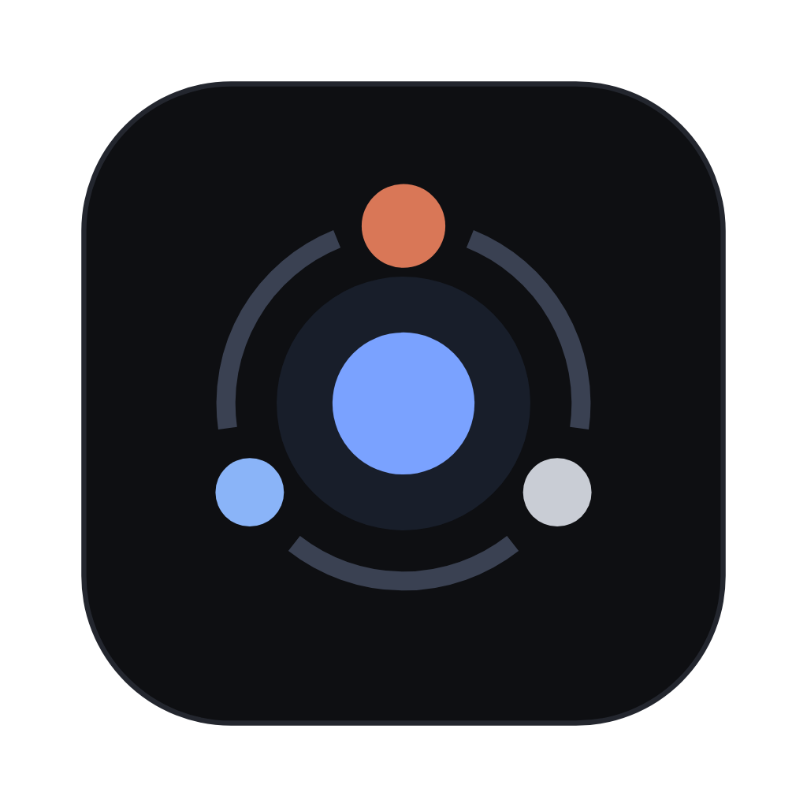
</p>

<h1 align="center">AgentHub</h1>

<p align="center">
  <strong>Um time de agentes de IA trabalhando no seu projeto — numa janela só.</strong><br>
  Claude Code, Codex e opencode lado a lado, com times, tarefas, rotinas, código e browser por projeto.
</p>

<p align="center">
  <a href="https://github.com/vftechbr/agent-hub-releases/releases/latest"><strong>⬇ Baixar a última versão</strong></a>
  &nbsp;·&nbsp; macOS · Windows · Linux
</p>

<p align="center">
  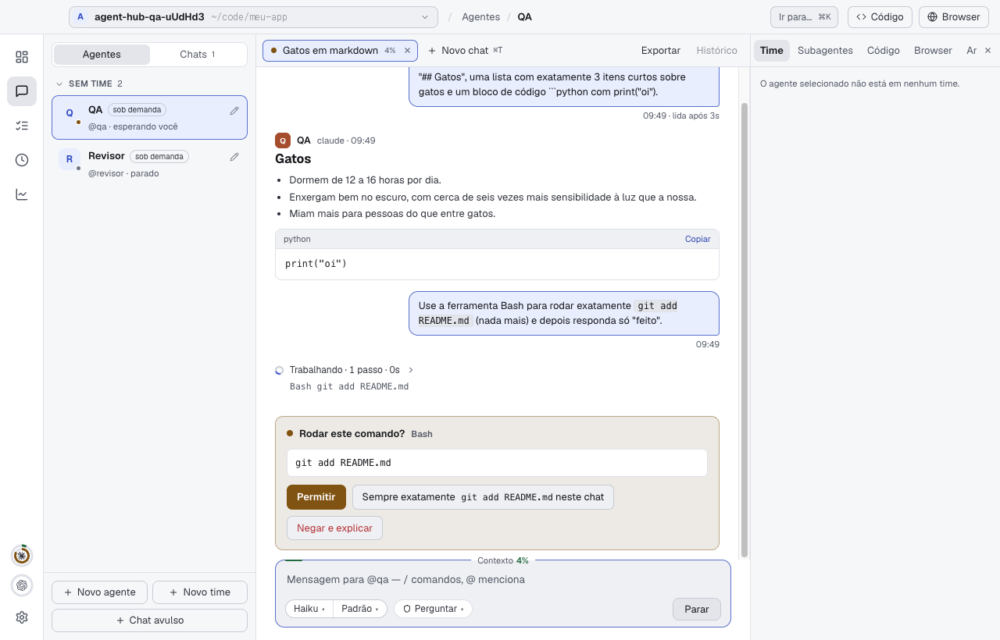
</p>

---

## Por que o AgentHub

Usar uma CLI de agente é ótimo. Usar cinco ao mesmo tempo vira um mar de abas de terminal, conversas perdidas e
nenhuma ideia de quem está fazendo o quê. O AgentHub junta tudo:

- **Vários agentes, várias CLIs.** Cada agente roda o Claude Code, o Codex ou o opencode que você já tem instalado,
  com a sua assinatura. Nada de chave de API nova.
- **Agentes que conversam entre si.** Um agente chama outro, delega uma tarefa e espera a resposta — você acompanha
  tudo e entra na conversa quando quiser.
- **Tudo do projeto num lugar.** Chats, tarefas, rotinas, arquivos alterados, terminais, browser e gasto de tokens,
  separados por projeto.
- **Roda no seu computador.** Seu código não sai da sua máquina além do que a própria CLI já envia.

---

## Monte o seu time

Crie agentes com papéis claros — QA, Revisor, Design, Backend — e organize-os em times. O mesmo agente pode estar em
mais de um time.

<p align="center">
  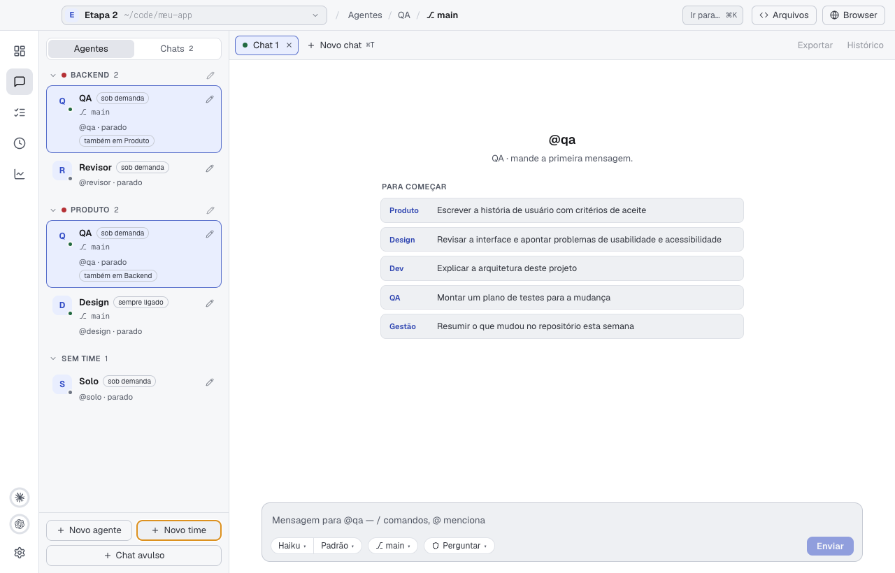
</p>

Cada agente tem a própria CLI e modelo, permissões, instruções, MCPs liberados e onde roda (na pasta do projeto ou numa
**worktree própria**, para trabalhar em paralelo sem pisar no código de ninguém). Ele pode ficar **sempre ligado** ou
subir **sob demanda**, quando alguém o chama, e fechar sozinho depois.

<p align="center">
  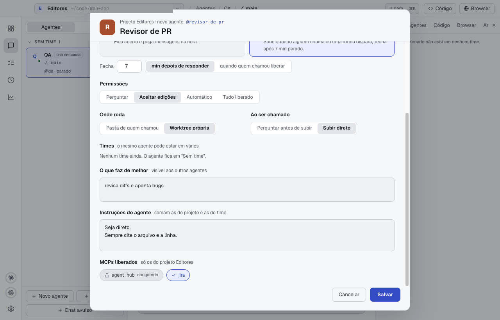
</p>

---

## Converse no chat

O chat mostra markdown, código, os passos do agente e pede sua aprovação antes de rodar comandos sensíveis:
**Permitir**, **Sempre permitir neste chat** ou **Negar e explicar**. Troque modelo, esforço e permissões direto no
campo de mensagem e veja quanto da janela de contexto já foi usada.

Subagentes que a CLI dispara aparecem num painel próprio, com o pedido, as ferramentas usadas e o resultado.

<p align="center">
  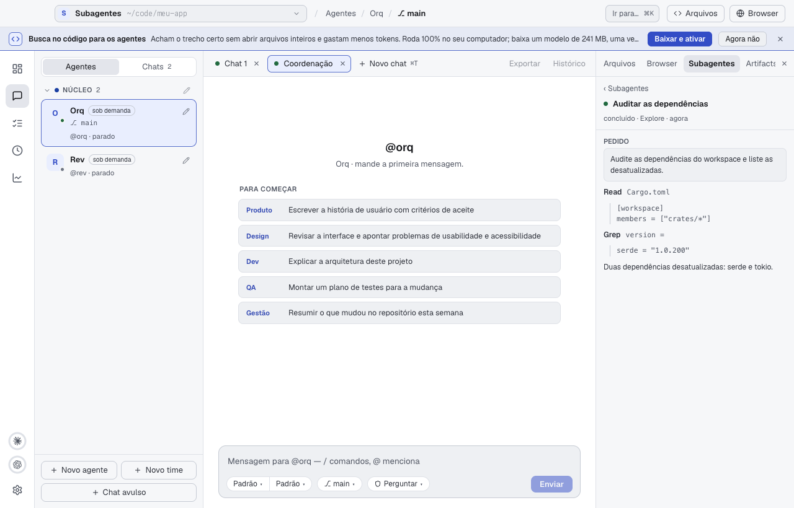
</p>

---

## Tarefas com vários agentes

Abra uma tarefa, escolha um dono e chame outros agentes com `@`. Perguntas e pedidos de permissão aparecem no fio da
tarefa, junto com o custo e os tokens gastos até ali.

<p align="center">
  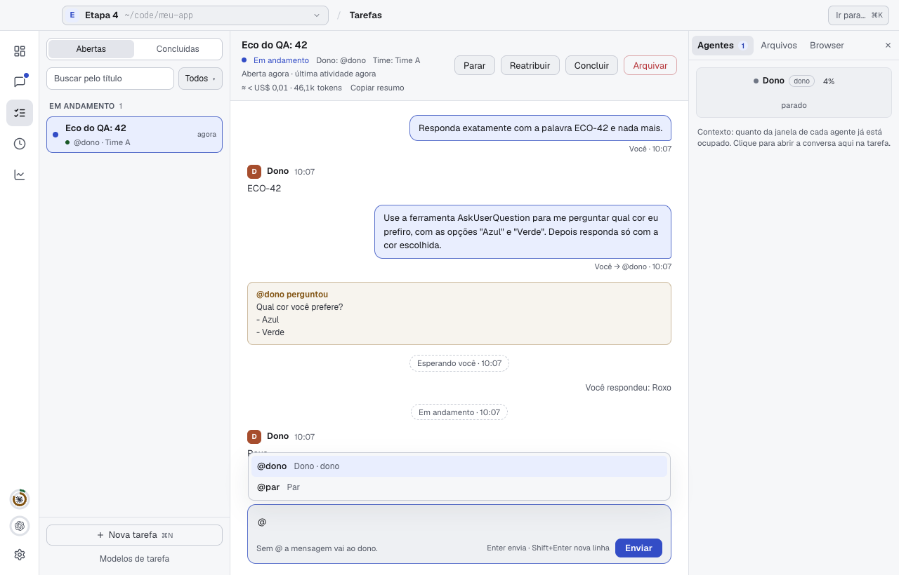
</p>

**Exemplo:**

```
Você  → @dono  Revise o PR da tela de login e peça ao @qa um plano de testes.
@dono → lê o diff, aponta dois problemas e chama o @qa
@qa   → devolve o plano de testes para o @dono
@dono → resume tudo para você e marca a tarefa como concluída
```

<p align="center">
  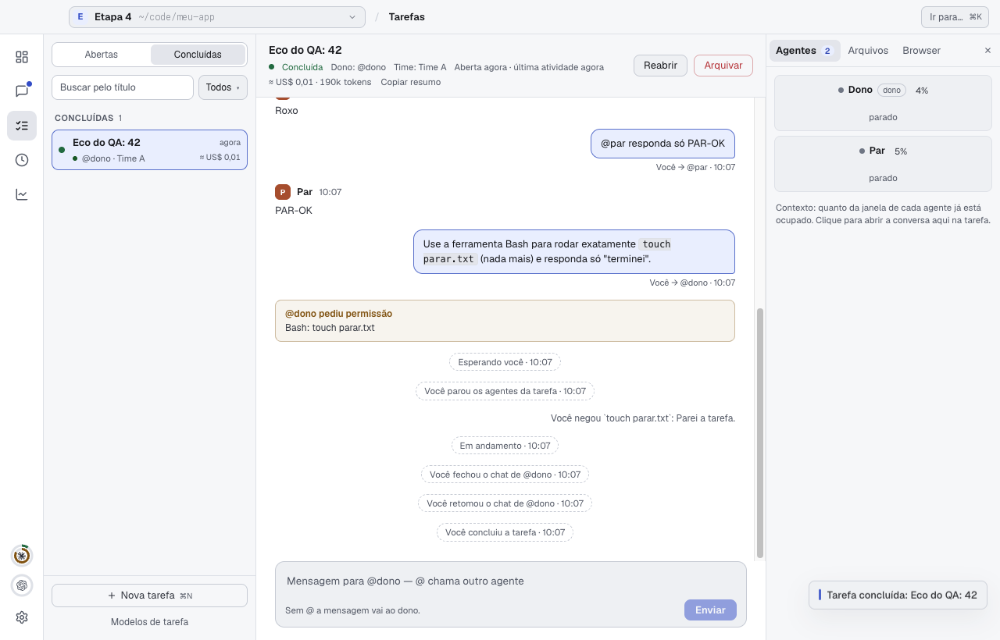
</p>

---

## Veja o que mudou

Os arquivos alterados pelos agentes aparecem ao lado do chat, com diff unificado ou lado a lado. Selecione um trecho e
mande para um agente com um clique.

<p align="center">
  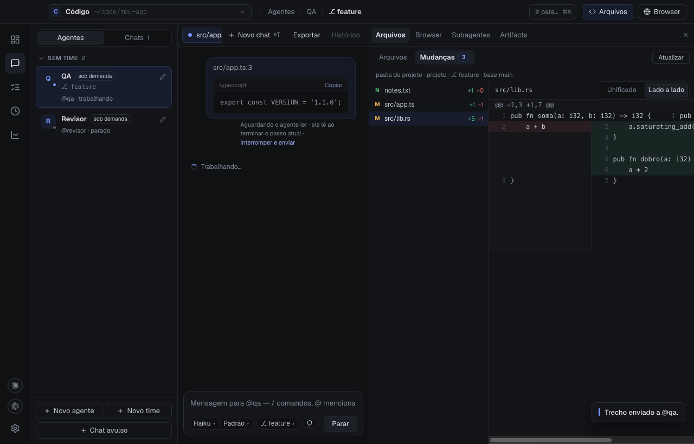
</p>

---

## Rotinas: agentes que trabalham sozinhos

Agende um agente por horário, por verificação, por comando, por **webhook** ou por evento do **GitHub**. Ele recebe a
instrução, faz o trabalho e deixa o resultado num chat.

<p align="center">
  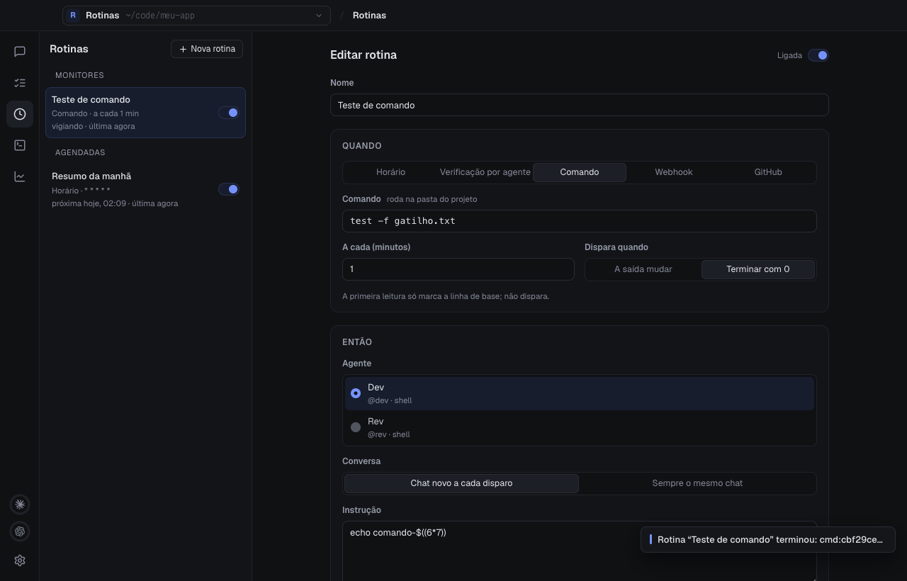
</p>

**Exemplos de rotinas:**

| Quando                         | Agente     | Instrução                                                    |
|--------------------------------|------------|--------------------------------------------------------------|
| Todo dia às 9h                 | `@gestao`  | Resuma o que mudou no repositório desde ontem.               |
| Abriram um PR no GitHub        | `@revisor` | Revise o diff e comente os problemas encontrados.            |
| `npm test` passou a falhar     | `@dev`     | Descubra por que o teste quebrou e proponha a correção.      |
| Chegou um webhook do monitor   | `@ops`     | Leia o alerta, investigue os logs e diga se é preciso agir.  |

---

## Controle de uso e custo

Acompanhe os limites de 5 horas e semanais do Claude e do Codex sem sair do app, e veja os tokens gastos por time, por
agente e por modelo.

<p align="center">
  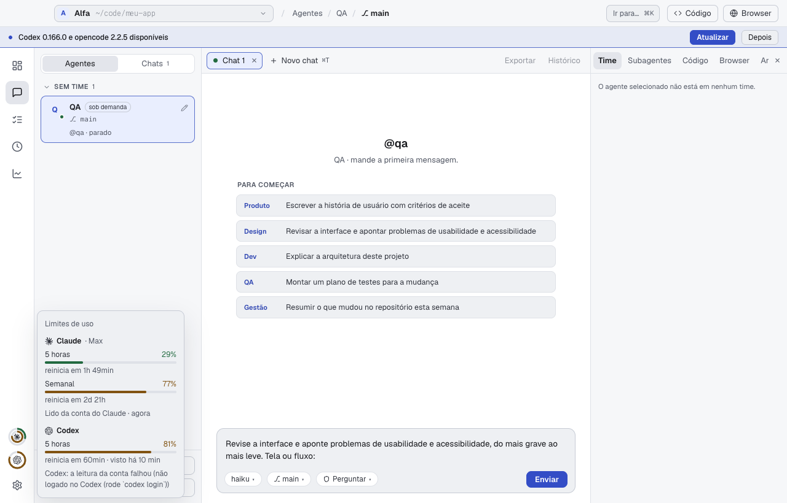
  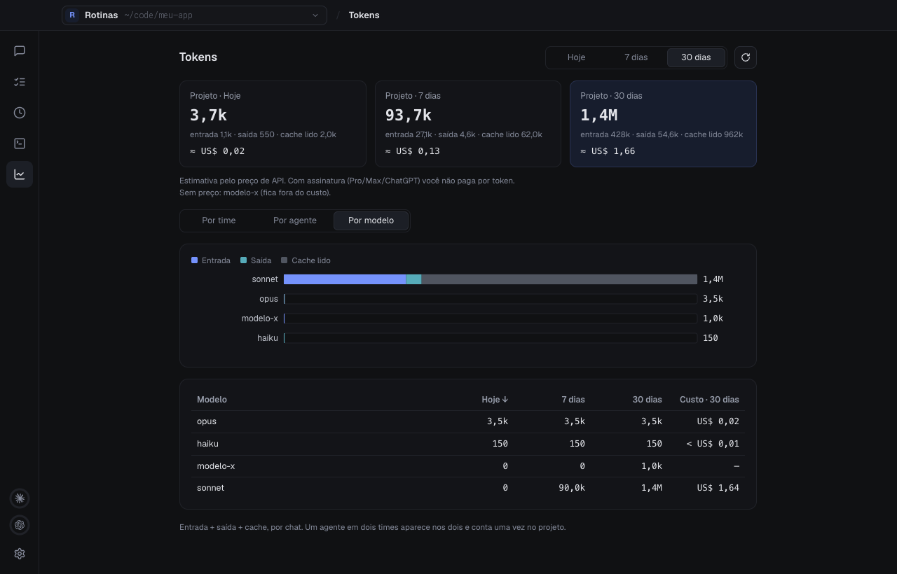
</p>

---

## MCPs por projeto

Cadastre os MCPs uma vez e libere para os times que precisam. Segredos ficam no keychain do sistema, nunca em arquivo.
Já tem MCPs configurados nas CLIs? Importe com um clique.

<p align="center">
  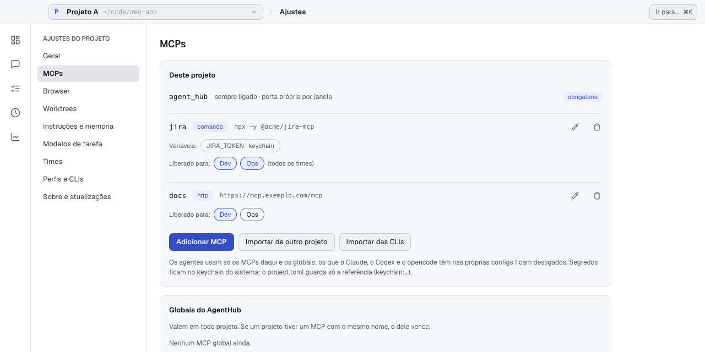
</p>

---

## E mais

- **Browser por projeto**, que os agentes também usam para testar páginas, com o seu login quando você permitir.
- **Artifacts do Claude** abertos num painel do próprio app.
- **Terminal rápido** (⌘⇧J no macOS, Ctrl+Shift+J no Windows e no Linux): um shell na pasta do projeto que desce
  por cima da janela e some com o mesmo atalho. Caminhos de arquivo na saída viram links que abrem o arquivo no app.
- **Memória do time**: decisões e armadilhas ficam guardadas e os agentes consultam antes de trabalhar.
- **Busca no código** local para os agentes acharem o trecho certo gastando menos tokens.
- **Atualizações automáticas**: o app procura versões novas aqui e avisa quando há uma.

---

## Instalar

1. Baixe o instalador do seu sistema em
   [**Releases**](https://github.com/vftechbr/agent-hub-releases/releases/latest):

   | Sistema               | Arquivo                                  |
   |-----------------------|------------------------------------------|
   | macOS (Apple Silicon) | `AgentHub-<versão>-mac-arm64.dmg`         |
   | macOS (Intel)         | `AgentHub-<versão>-mac-x64.dmg`           |
   | Windows               | `AgentHub-<versão>-win-x64.exe`           |
   | Linux                 | `.AppImage` ou `.deb`                    |

2. Tenha ao menos uma CLI instalada e logada: [Claude Code](https://docs.anthropic.com/claude-code),
   [Codex](https://github.com/openai/codex) ou [opencode](https://opencode.ai) (2.x).
3. Abra o AgentHub, escolha a pasta do projeto e crie seu primeiro agente.

> **macOS:** o app é assinado e notarizado pela Apple.<br>
> **Windows:** o instalador não é assinado; se o SmartScreen avisar, clique em **Mais informações → Executar assim mesmo**.
