<p align="center">
  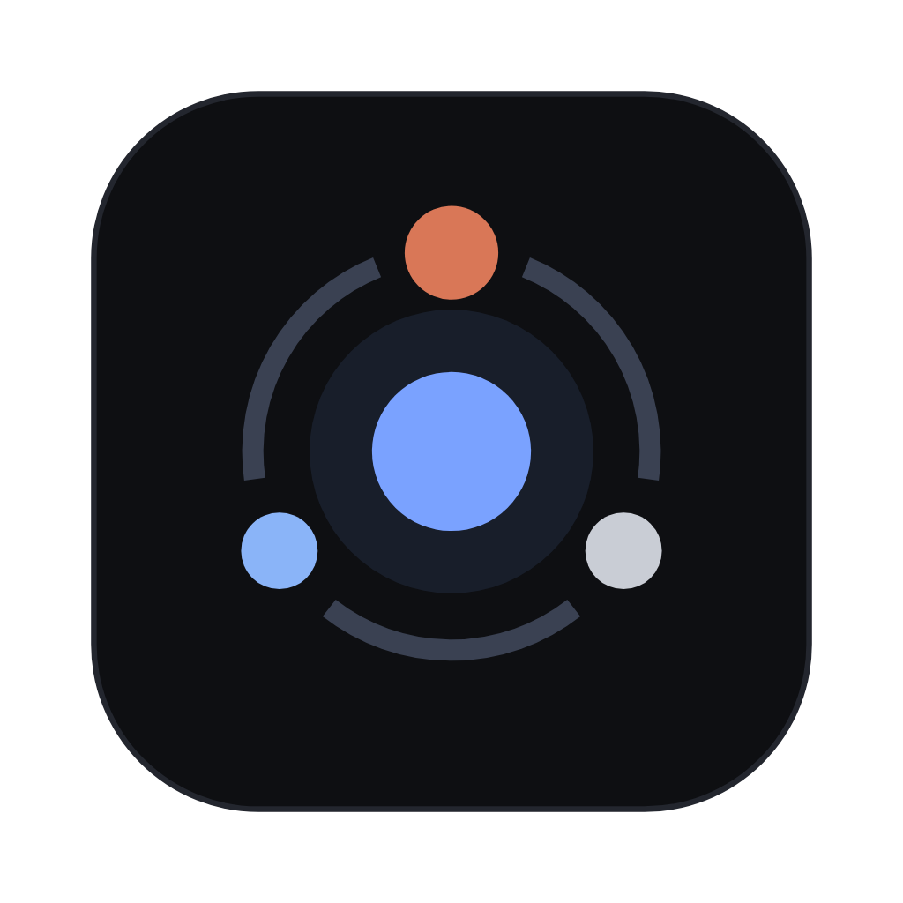
</p>

<h1 align="center">AgentHub</h1>

<p align="center">
  <strong>Um time de agentes de IA trabalhando no seu projeto, numa janela só.</strong><br>
  Claude Code, Codex, opencode, Grok e Antigravity lado a lado, com times, tarefas, rotinas, código e browser por projeto.
</p>

<p align="center">
  <a href="https://github.com/vftechbr/agent-hub-releases/releases/latest"><strong>⬇ Baixar a última versão</strong></a>
  &nbsp;·&nbsp; macOS · Windows · Linux
</p>

<p align="center">
  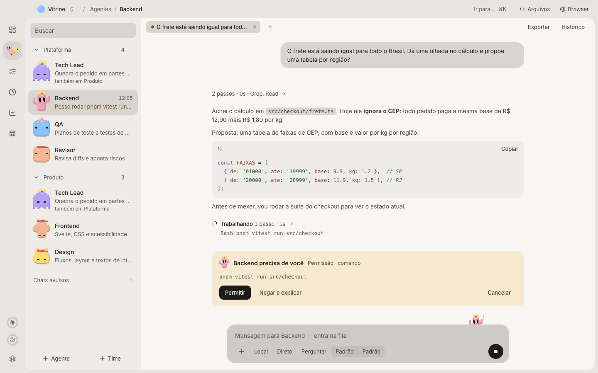
</p>

---

## Por que o AgentHub

Usar uma CLI de agente é ótimo. Usar cinco ao mesmo tempo vira um mar de abas de terminal, conversas perdidas e
nenhuma ideia de quem está fazendo o quê. O AgentHub junta tudo:

- **Vários agentes, várias CLIs.** Cada agente roda o Claude Code, o Codex, o opencode, o Grok ou o Antigravity que
  você já tem instalado, com a sua assinatura. Nada de chave de API nova.
- **Agentes que trabalham juntos.** Numa tarefa, o dono divide o pedido em subtarefas para o time e recebe tudo de
  volta. Você acompanha o fio e entra na conversa quando quiser.
- **Tudo do projeto num lugar.** Chats, tarefas, rotinas, arquivos alterados, worktrees, terminal, browser e gasto de
  tokens, separados por projeto.
- **Roda no seu computador.** Seu código não sai da sua máquina além do que a própria CLI já envia.

---

## Visão geral

Ao abrir o projeto, a **Visão geral** mostra em um olhar quem está esperando você, quem está trabalhando, as tarefas
abertas, as próximas rotinas e quanto o time gastou hoje. Cada item leva direto ao chat, à tarefa ou à rotina.

<p align="center">
  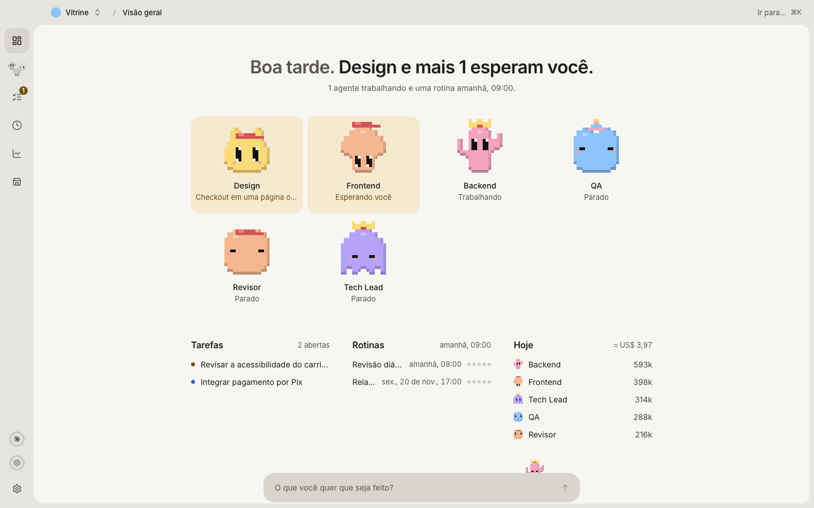
</p>

---

## Monte o seu time

Crie agentes com papéis claros (Tech Lead, Backend, Frontend, QA, Revisor, Design) e organize-os em times. O mesmo
agente pode estar em mais de um time. Cada um ganha um personagem, que mostra na lateral se está trabalhando, parado ou
esperando você.

Cada agente tem a própria CLI, modelo e esforço, instruções, permissões e MCPs. Ele pode ficar **sempre ligado** ou
subir **sob demanda**, quando alguém o chama, e fechar sozinho depois.

<p align="center">
  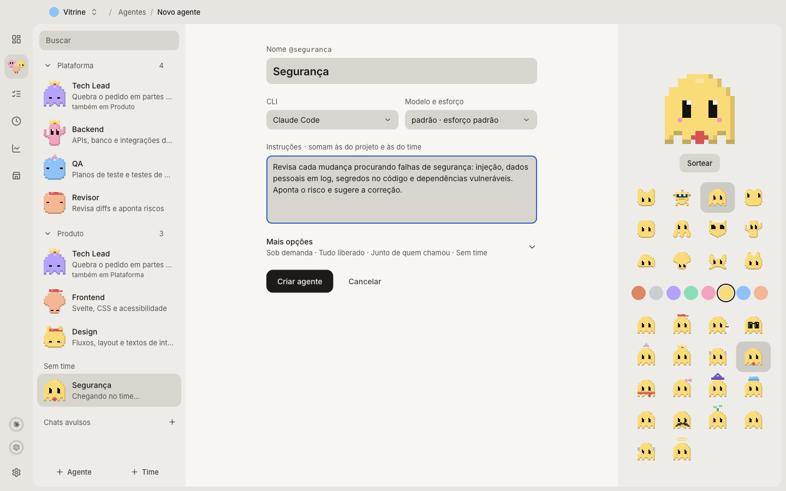
</p>

---

## Converse no chat

O chat mostra markdown, código e os passos do agente, e pede sua aprovação antes de rodar comandos sensíveis:
**Permitir**, **Negar e explicar** ou **Cancelar**. No campo de mensagem você escolhe onde o chat trabalha, o modo
(**Direto** ou planejar antes), as permissões e o modelo, e vê quanto da janela de contexto já foi usada. Mensagens
enviadas enquanto o agente trabalha entram na fila.

Subagentes que a CLI dispara aparecem na aba **Subagentes**, com o pedido, as ferramentas usadas e o resultado.

---

## Tarefas com vários agentes

Abra uma tarefa, escolha um dono e deixe o time trabalhar. O dono divide o pedido em **subtarefas** para outros
agentes, que devolvem o resultado no fio da tarefa. Quando todas voltam, o dono recebe tudo junto e responde a você.
Perguntas, pedidos de permissão, custo e tokens gastos aparecem no mesmo fio.

<p align="center">
  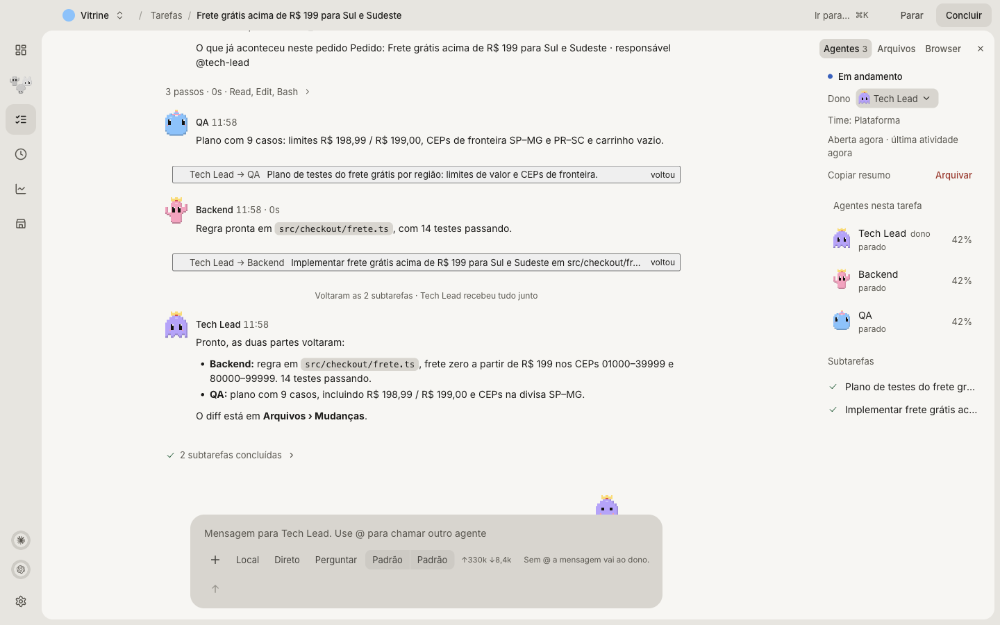
</p>

**Exemplo:**

```
Você       → Frete grátis acima de R$ 199 para Sul e Sudeste
Tech Lead  → abre uma subtarefa para o Backend (a regra) e outra para o QA (o plano de testes)
Backend    → muda src/checkout/frete.ts, roda os testes e devolve
QA         → devolve um plano com 9 casos
Tech Lead  → recebe as duas partes e resume tudo para você
```

### Pedido em roda

Quer opiniões independentes? Marque dois ou mais agentes, ou escreva `@todos`. Cada um responde por conta própria,
sem ver a resposta dos outros, e a roda fecha quando todos responderam.

<p align="center">
  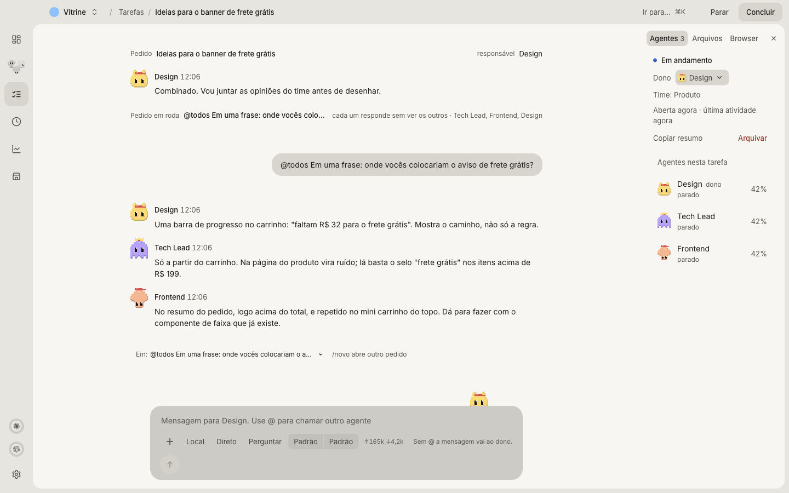
</p>

### Limites de delegação

Em **Ajustes › Delegação** você define, por pedido, quantas subtarefas, consultas e passagens de responsável um agente
pode abrir, e quantas subtarefas rodam ao mesmo tempo. Ao passar do limite, o AgentHub pode **só avisar no fio** (o
padrão) ou **perguntar a você** antes de seguir.

<p align="center">
  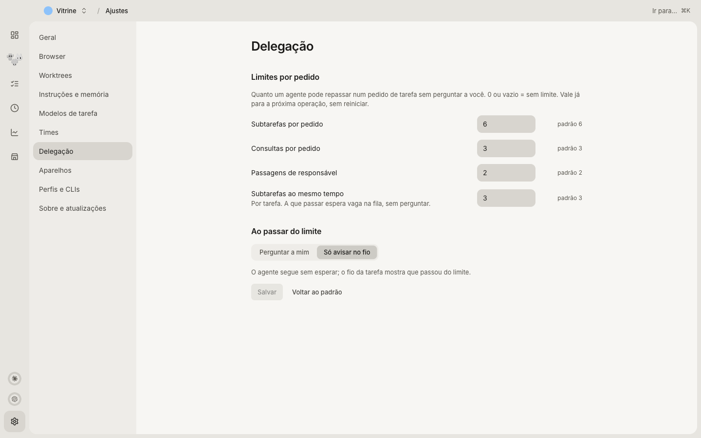
</p>

---

## Veja o que mudou

Os arquivos alterados pelos agentes aparecem em **Arquivos › Mudanças**, ao lado do chat, com diff unificado ou lado
a lado. Dali mesmo você faz o commit ou cria a branch e o PR. Selecione um trecho e mande para um agente com um clique.

<p align="center">
  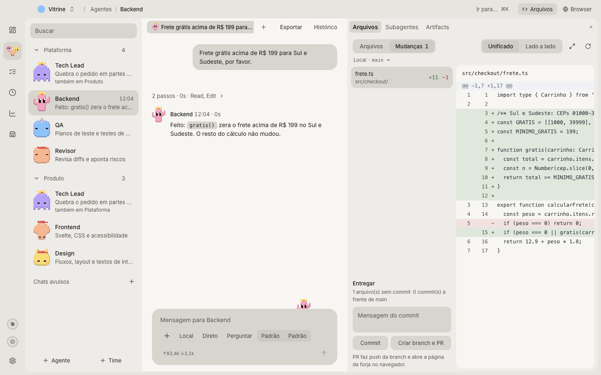
</p>

### Worktrees

Cada chat pode trabalhar direto na pasta do projeto (**Local**) ou numa **Worktree** só dele, criada a partir da branch
que você escolher, inclusive uma que só existe no remoto. Assim dois agentes mexem no mesmo repositório ao mesmo tempo
sem pisar um no outro. Quando o trabalho estiver bom, você faz o merge.

<p align="center">
  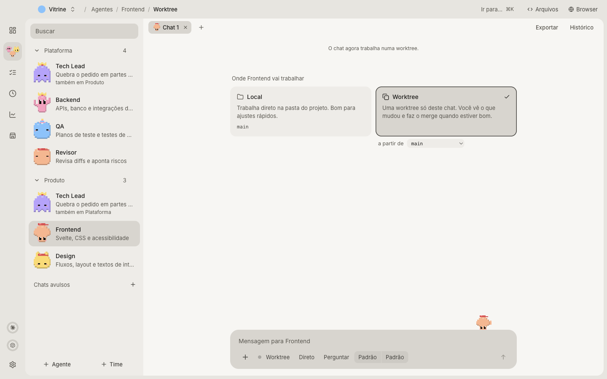
</p>

---

## Rotinas: agentes que trabalham sozinhos

Monte fluxos com blocos, sem escrever código. Uma rotina começa por um gatilho (**horário**, **verificação por
agente**, **comando** ou um **conector**: PR aberto ou atualizado no GitHub ou no Bitbucket, ou falha de CI) e segue
bloco a bloco:

- **Agente:** pede algo a um agente do projeto e guarda a resposta.
- **Comando:** roda um comando na pasta do projeto.
- **Se / senão:** segue por um caminho ou outro conforme o que os blocos anteriores devolveram.
- **Perguntar a você:** para e pergunta (sim ou não, opções ou texto), com prazo; cada resposta tem o seu caminho.
- **Esperar:** segura a execução até um horário ou por alguns minutos.
- **Avisar você**, **criar tarefa** ou **comentar no PR**.

<p align="center">
  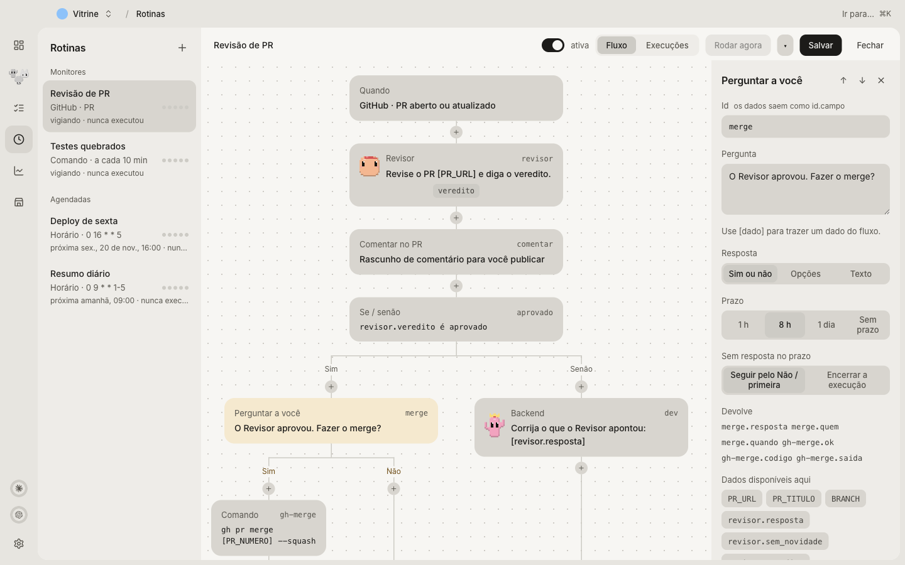
</p>

No exemplo acima, a cada PR aberto ou atualizado o Revisor revisa e dá um veredito, e a rotina comenta no PR. Se ele
aprovou, a rotina pergunta a você se faz o merge. Senão, o Backend recebe o que o Revisor apontou e corrige. Use
**Rodar agora** para disparar na hora, ou **Ensaiar…** para rodar com um evento de exemplo, sem efeitos. Cada execução
fica registrada com os blocos que rodaram e o caminho que seguiu.

**Mais exemplos:**

| Quando                        | Fluxo                                                                    |
|-------------------------------|--------------------------------------------------------------------------|
| Dias úteis às 9h              | Tech Lead resume o que mudou ontem → avisar você                         |
| `pnpm vitest run` mudou       | QA descobre por que quebrou → criar tarefa com a correção proposta       |
| Sexta às 16h                  | esperar até 17h30 → `pnpm deploy` → avisar você                          |
| Falha de CI no GitHub         | Backend investiga → se for o teste, corrige; senão, pergunta a você      |

---

## Browser e prévia

Cada projeto tem o seu browser, que os agentes também usam para testar páginas, com o seu login quando você permitir.
Quando um agente sobe o servidor de desenvolvimento (Vite, Next, Laravel…), a página abre sozinha numa aba do browser
do projeto e o chat avisa. Serviços que não servem página, como Postgres ou Redis, ficam de fora.

<p align="center">
  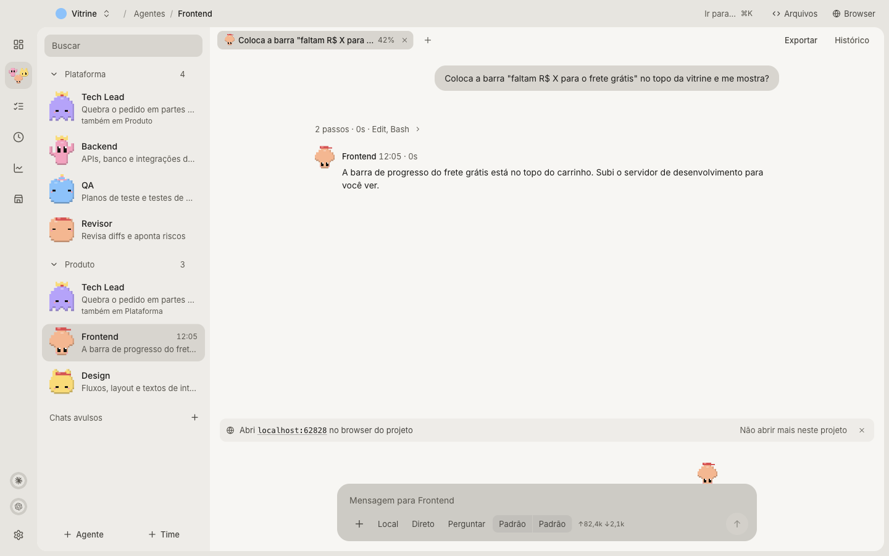
</p>

---

## Controle de uso e custo

Acompanhe os limites de 5 horas e semanais do Claude e do Codex nos anéis do canto da janela, e veja na aba
**Tokens** quanto cada time, agente e modelo gastou. Defina um orçamento mensal e exporte em CSV.

<p align="center">
  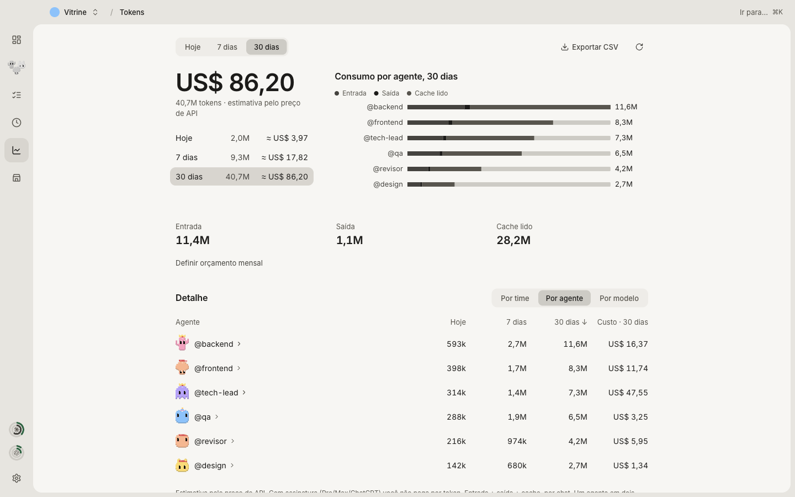
</p>

<p align="center">
  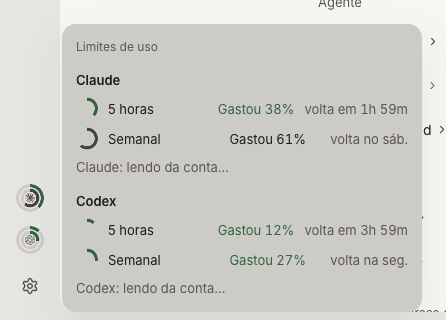
</p>

---

## Conectores

Na **Loja**, ligue as ferramentas com que seus agentes trabalham (GitHub, Bitbucket, Linear, Jira, Sentry, Stripe e
dezenas de outras) ou cadastre um conector personalizado. Segredos ficam no keychain do sistema, nunca em arquivo.

<p align="center">
  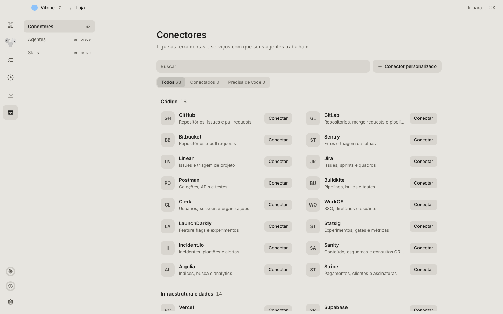
</p>

---

## E mais

- **Artifacts do Claude** abertos num painel do próprio app.
- **Terminal rápido** (⌘⇧J no macOS, Ctrl+Shift+J no Windows e no Linux): um shell na pasta do projeto que desce
  por cima da janela e some com o mesmo atalho. Caminhos de arquivo na saída viram links que abrem o arquivo no app.
- **Ir para…** (⌘K no macOS, Ctrl+K no Windows e no Linux): pula para qualquer agente, chat, tarefa ou aba, e cria
  tarefa, agente ou time sem tirar a mão do teclado.
- **Memória do time**: decisões e armadilhas ficam guardadas e os agentes consultam antes de trabalhar.
- **Busca no código** local para os agentes acharem o trecho certo gastando menos tokens.
- **Atualizações automáticas**: o app procura versões novas aqui e avisa quando há uma. Também avisa quando sai versão
  nova de uma CLI e atualiza com um clique.

---

## Instalar

1. Baixe o instalador do seu sistema em
   [**Releases**](https://github.com/vftechbr/agent-hub-releases/releases/latest):

   | Sistema               | Arquivo                                                        |
   |-----------------------|----------------------------------------------------------------|
   | macOS (Apple Silicon) | `AgentHub-<versão>-mac-arm64.dmg`                              |
   | macOS (Intel)         | `AgentHub-<versão>-mac-x64.dmg`                                |
   | Windows               | `AgentHub-<versão>-win-x64.exe`                                |
   | Linux                 | `AgentHub-<versão>-linux-x86_64.AppImage` ou `AgentHub-<versão>-linux-amd64.deb` |

2. Tenha ao menos uma CLI instalada e logada:
   [Claude Code](https://docs.claude.com/en/docs/claude-code/setup), [Codex](https://github.com/openai/codex),
   [opencode](https://opencode.ai/docs/) (2.x), [Grok](https://docs.x.ai/build/overview) ou
   [Antigravity](https://antigravity.google/download) (`agy`).
3. Abra o AgentHub, escolha a pasta do projeto e crie seu primeiro agente.

> **macOS:** o app é assinado e notarizado pela Apple.<br>
> **Windows:** o instalador não é assinado; se o SmartScreen avisar, clique em **Mais informações → Executar assim mesmo**.
